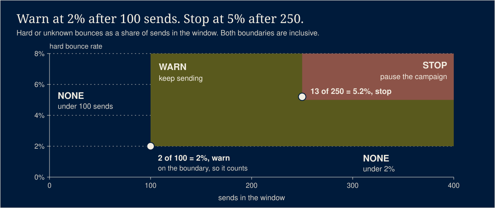

# email-bounce-breaker

For four months my hard-bounce suppressor ran dead. The webhook read a field the provider did not
send, nothing errored, and the only symptom was a campaign circuit breaker that kept tripping on a
list nothing was cleaning. These two small libraries are what came out of it: a bounce classifier
pinned to the provider's real payload shape, and a breaker that warns at 2% hard bounces after 100
sends and stops at 5% after 250, where unknown counts as hard and transient never counts.

## What it does



Two ES modules with zero dependencies, for anyone who sends bulk email.

- `lib/resend-bounce.js` reads a Resend `email.bounced` webhook payload into one flat verdict:
  `{ type, subType, message, isHard }`. It reads `data.bounce.type`, where Resend puts it, and
  falls back to the old flat `data.bounce_type` field only when the nested one is missing.
  `isHardBounceType()` reads a stored type and returns `null` for a missing one, never `false`,
  so an unknown bounce cannot pass as harmless.
- `lib/email-breaker.js` turns two numbers (sends in this window, hard or unknown bounces of
  those sends) into a tier: `none`, `warn` or `stop`. It warns at 2% once 100 sends are in the
  window and stops at 5% once 250 are. Both boundaries are inclusive.
- The same file carries two helpers for A/B testing a campaign, for example two subject lines.
  `assignVariant()` puts each recipient in arm A or B by hashing a stable id, so a person lands
  in the same arm every time the send queue is rebuilt and the test never measures two mixed
  groups. `pickTemplate()` picks the template a queued job sends: its own arm's, or the winner's
  once a human promotes one, so the rest of the list gets the better version.

No database, no network, no clock. Same inputs, same answer.

## Run it

Node 20 or newer. Copy the two files in `lib/` into your project, or install from GitHub:

```bash
npm install github:jaysueno/email-bounce-breaker
```

```js
import { readBounce, isHardBounceType } from 'email-bounce-breaker/resend-bounce';
import { breakerVerdict } from 'email-bounce-breaker/email-breaker';

// In the webhook: suppress only on a hard verdict.
const { isHard } = readBounce(event.data);
if (isHard) await suppress(event.data.to); // your own suppression write

// In the send loop: count hard OR unknown, never transient.
const hardBounced = storedTypes.filter((t) => isHardBounceType(t) !== false).length;
const verdict = breakerVerdict({ sentInWindow: 250, hardBounced });
if (verdict.tier === 'stop') await pauseCampaign(); // your own pause
else if (verdict.tier === 'warn') await alert(verdict.rate); // keep sending
```

## Test it

[](https://github.com/jaysueno/email-bounce-breaker/actions/workflows/ci.yml)

```bash
npm ci
npm test
```

`npm test` runs `node --test` over `test/`. The test names include the four invariants this code
must keep. They keep the numbers they have in the source rule; invariants 4, 5, 6 and 8 cover code
this repo does not ship.

- invariant 1: real email.bounced payload classifies hard
- invariant 2: unclassifiable bounce counts toward stop
- invariant 3: campaign breaker warns at 2% after 100 and stops at 5% after 250
- invariant 7: transient bounce is never suppression evidence

One more test, `legacy flat read yields empty`, pins the original bug: on the real payload shape,
the old flat read returns an empty string. `test/fixtures/email-bounced.json` has the shape of
Resend's documented `email.bounced` example (checked against resend.com/docs on 2026-11-08).
Every value in it is invented.

## How it works


```
  Resend webhook (email.bounced)            send loop, one drain window
              |                                 S sends, their stored bounce types
              v                                            |
  readBounce(data)                                         v
    reads data.bounce.type                     isHardBounceType(type)
    flat bounce_type only as a fallback          permanent -> true   counts
              |                                  null      -> null   unknown, counts
              v                                  transient -> false  never counts
  isHard? suppress the address                             |
                                                           v  H = hard + unknown
                                               breakerVerdict({ S, H })
                                                 S < 100               -> none
                                                 S >= 100, H/S >= 2%   -> warn, keep sending
                                                 S >= 250, H/S >= 5%   -> stop, pause
```

The old webhook read `data.bounce_type`. Resend sends `data.bounce.type`. The read was always
empty, so no bounce ever counted as hard and no address was ever suppressed. The same dead
addresses bounced again on every send, and the breaker of the time (2% of all bounces after 100
sends, one tier, hard pause) tripped every morning on two bounces out of a hundred.

Two fixes came out of it. The classifier reads the field the provider actually sends, and a test
pins the payload shape. The breaker got two tiers and a bigger denominator for the one that
pauses: a warning costs nothing, a pause costs a human re-confirm, so the pause waits for a
window big enough to mean something. Only hard bounces count toward it. A transient bounce (a
full mailbox, greylisting) is not a dead address. A bounce with no type at all counts, because
treating unknown as harmless is how the first bug stayed hidden.

## What it will not do

- It does not query, store, suppress or pause anything. Your code passes the numbers in and acts
  on the verdict.
- It does not decide what a window is. The send loop picks the sends and matches their bounces.
- It does not count complaints. Bulk-sender guidance from Gmail and Yahoo caps complaints at
  0.3%, far below these bounce numbers; track them on their own.
- It treats Resend's `Undetermined` type as not hard. Only a missing type is unknown.
- It does not include a breaker for low-volume lifecycle flows, where a handful of sends makes any
  rate noise. That needs its own sample floor.
- It has only been tested against Resend's payload shape.

## License

MIT. See [LICENSE](LICENSE).
